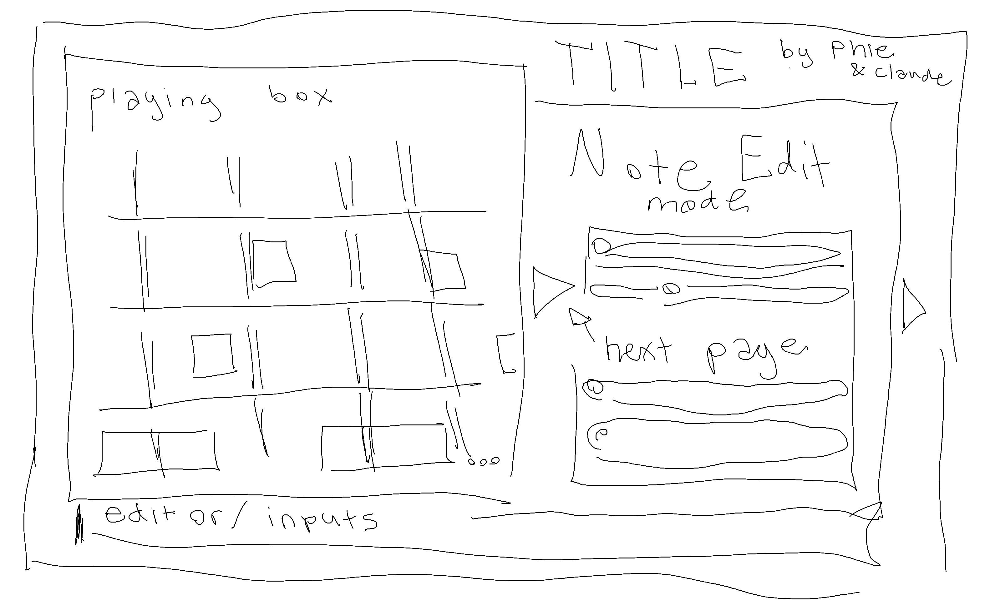

# mpwav — Design

Shared, commentable version (the one to edit and hand in):
https://claude.ai/code/artifact/4335e52a-e095-44b2-b6ed-ce0a0e6edf48 — this file is the repo copy, kept in step with it.

As of 2026-10-07. Status: agreed direction, not built yet.

## Overview

mpwav will open on an Ableton-style timeline where every track's music sits in colored blocks that you place, stretch, copy and paste. It is a browser music studio for musically inclined beginners and intermediates, sighted or visually impaired, built for Creative Coding & Innovation.

**The class brief requires** (Weeks 8–9, Built For Them, as of 2026-10-17): a 3-sentence audience statement, three user contexts with one change for each, it works on a phone, meets WCAG AA contrast, is keyboard-navigable and works with screen readers, ships as a live URL, both partner audit lists fixed, CREDITS.md, a poster and a narrated demo video, shown at the critique on Oct 19.

## Audience

mpwav is for people who are blind or have low vision and want to start making music, often on the phone they already use with a screen reader, and with little or no music theory. They want to make a short song, a beat or a sound effect from scratch, hear it back, and save or share it, all without asking a sighted person for help. Most music apps are built for sighted, experienced producers: you drag small blocks and turn knobs on a screen sized for a mouse, many controls have no name a screen reader can say, and the accessible setups that do exist usually mean a desktop computer, add-on scripts and knowing the jargon first.

## Three user contexts

| User | Their situation | What mpwav changed for them |
|---|---|---|
| **Ideal** | A VoiceOver or TalkBack user on a recent phone, with headphones and an hour free, who wants to finish a whole short song | **Nothing has to be dragged.** The keyboard is real buttons, step input writes notes at the cursor as keys are played, the wave editor takes typed Select from / to / Length, and every action is spoken through a live region |
| **Budget** | An old Android phone or a shared school laptop, no admin rights, spotty wifi | **Nothing to install, no account, and it works offline.** It's one static site with no libraries. After the first visit the service worker serves it from the cache when the network takes over 3 seconds, and songs save on the device |
| **Chaotic** | A low-vision user making a beat on their phone in a hallway between classes, 17 tabs open, no patience, interrupted halfway | **Nothing is lost when they leave.** Every change saves itself within a fifth of a second, and Undo goes back 100 steps. The phone layout also pins the keyboard and play bar, every color theme passes AA contrast, and text goes up to Extra large |

## What testing found, and what changed

Testers had fun using mpwav, and the audit partners didn't find it hard to understand.
What tripped them up was getting results they didn't expect, because the page wasn't
clear about what it was showing: the layout, or the format changing under them. So the
process is split into clear, accessible steps for people getting into sound design, and
the page now says what changed whenever it changes. Both accessibility audits were done
(Week 8 and Week 9); in class we agreed this deliverable is freeform, so the findings are
summed up here rather than itemized. Phie's own tests added one more goal: getting work out
of mpwav faster, in whatever form it's needed next.

| What it fixes | What we changed | Version |
|---|---|---|
| Unexpected results when the layout or a slide changed with no word about it | **A notice says what changed.** Switching slides shows and speaks what the slide is for, and which clip it opened ("Make: play and record ideas into one clip. Opened Lo-fi Chords on Chords."). Resizing the window, turning a phone or changing Settings › Layout says the new layout. It sits at the bottom of the screen for 4.5 seconds, above the pinned keyboard on phones | v0.26.0 |
| A clearer way in | **Guided tour:** 12 steps, each ringing one real control, in an accessible dialog (focus stays in it, Esc ends it). It runs once on a first visit and replays from Settings › Tutorial | v0.9.0, v0.25.0 |
| Too much on one screen, and jumping between editing jobs | **Slides:** Make, Arrange, Edit, Sound and Mix each show only the panels that job needs, plus All. Switch with the slide buttons or Alt + 1 to 6, while Play, Record and Undo stay put on every slide | v0.19.0 |
| New to making music | **The Guide:** a drawer in the top bar with scale notes on the computer keys, chords that fit and what they do, 5 patterns to play, beat basics, tips and a glossary | v0.24.0 |
| Coming from Ableton or Cool Edit | Their names for each panel as hover hints, and a mapping table plus shortcuts in the Guide | v0.25.0 |
| Getting work out efficiently (Phie's tests) | **Several export modes:** Home › Export makes the whole mix (WAV or AIFF, 16/24/32-bit, 44.1/48 kHz, normalize, dither, ring-out tail), stems as a .zip, MIDI, or song info as text, for the whole song, the loop or chosen bars. One clip exports on its own (a note clip comes with its MIDI). The wave editor's Export menu saves a selection, the parts between markers, or variations. Every sound export shows its peak and loudness (LUFS) | v0.22.0 to v0.24.0 |
| A look that's mpwav's own, and still readable | **The Poster look:** the whole design now follows Phie's mpwav poster: periwinkle into violet, cream lettering, rounded wave bars and flowing curves behind the panels, and her title lettering on Home. The colors are deepened so the cream text passes WCAG AA, and every color pair is covered by the contrast tests. It's the default theme | v0.21.0 |

**What exists today** ([live site](https://soapiessoapies.github.io/mpwav/)): four synth tracks (Lead, Bass, Pad, Hat), a mixing desk, a 16-step pattern grid with slots A–D, recording from the keyboard, a 16-bar arrangement grid, the Sound tab (synth, morph pad, Warp effects) and tabs for small screens. This design replaces the pattern grid and arrangement grid with one timeline; the sound and mixer parts stay.

## Layout sketch

The screen splits into three areas: the timeline on the left, a paged editing panel on the right under the title, and an inputs strip across the bottom.

- **Transport bar** (above the playing box): Play, Record, tempo.
- **Playing box** (left, most of the screen): the timeline of clips. Track rows, bar lines, clips of different widths, and "…" where it keeps growing.
- **Title** (top right): the song's title and "by Phie & Claude".
- **Note Edit mode** (right): rows of sliders, a page at a time, with arrows between pages. Some pages edit the selected notes (length, loudness, pitch); the others edit the selected track's sound (synth, morph pad, Warp, output).
- **Editor / inputs** (bottom strip, full width): the keyboard and other input controls.

## The timeline (main view)

The app opens on the timeline: every track stacked as a row, time running left to right in bars, like Ableton's Arrangement View.

- **Tracks as rows.** Lead, Bass, Pad and Hat each get a row; the selected track's row is highlighted. Selecting a track is how you reach its output settings (sound, mixer, note length).
- **It grows as you work.** There is no fixed song length. The song ends a couple of empty bars after the last block, and placing a block near the end adds more room.
- **A playhead** sweeps across while playing. Tap or click the ruler at the top to move it; Play starts from there.
- **Loop brace.** A bracket on the ruler marks a section to repeat while you work on it (Ableton's loop switch). Off = play the whole song.
- **Zoom.** Pinch on a phone, Ctrl + wheel on Windows, or + / − buttons: zoomed out shows the whole song, zoomed in shows single steps.
- **Zoom bar (like Premiere Pro).** A thick bar under the timeline, and another under the piano roll, shows which part is in view. Drag its middle to scroll; drag either end to zoom. Double-click it, press Fit, or press \ to fit everything. Until you zoom by hand the song keeps fitting the width as it grows. The bar never gets thinner than a finger can grab, and from a keyboard its middle and ends are sliders (arrows, - / =, Home / End).
- **Collapsible rows.** Each track row folds to a thin strip; Collapse rows folds them all.

## Clips, not loose notes

Recommendation: the timeline holds **clips** (blocks of notes), and you open a clip to edit its notes, as in Ableton. It is the fastest way to arrange because you build a part once and reuse it everywhere.

| Action | With clips | With loose notes on the timeline |
| --- | --- | --- |
| Repeat a 1-bar beat for 8 bars | Drag the clip's right edge out | Copy and paste 8 times |
| Change the beat everywhere it repeats | Edit one linked clip | Edit every copy by hand |
| Make a variation | Duplicate the clip, then edit the copy | Select, copy, paste, edit |
| See the song's shape | Named, colored blocks per section | Thousands of tiny notes |

- **Clip editor.** Double-click (tap twice on a phone) a clip to open its notes in a piano-roll editor docked under the timeline. Notes are the colored blocks described below.
- **Linked vs independent copies.** Alt-drag (or Copy as linked) makes a linked copy that changes when the original does; a normal copy is independent. Linked clips show a small chain mark.
- **Clip library.** Each track keeps a list of its clips (this replaces the A–D slots, with no limit of four). Clips get names like "Verse beat", and can be dragged from the list onto the timeline.
- **Recording** makes a new clip where the playhead is, or adds into the clip under it (adding with Undo take, as now).

## Placing notes

In the clip editor, scrolling moves through the pitch rows, tapping places a note, and the keyboard can type notes in at a cursor. All three work on phone and Windows.

**Scrolling the pitch rows.** The editor shows about one octave at a time; scroll up and down for higher or lower notes, with the piano keys along the left edge as a guide.

| | Phone | Windows |
| --- | --- | --- |
| Move through pitches | Swipe up / down | Mouse wheel |
| Move through time | Swipe left / right | Shift + wheel, or the scrollbar |
| Place a note | Tap a square | Click a square |
| Zoom | Pinch | Ctrl + wheel |

Scrolling works well on Windows too: a wheel is quicker than the current − / + row buttons, and those buttons stay for keyboard and screen-reader users.

**Keyboard as the pitch input (step input).** Put the cursor at a point in the clip, then press a piano key (on screen or A W S E D…): that note lands at the cursor and the cursor moves on by one note length. Hold two keys for a chord. This is also the main way screen-reader users write music, since it needs no pointing.

**Note length.** Every note is a block whose width is how long it plays. Drag a block's right edge to stretch or shorten it, or set a default length for new notes (1/16, 1/8, 1/4, 1/2, one bar). It replaces today's per-track Note length dropdown, so one bass part can mix long and short notes. Keyboard: Shift + ← / → shortens or lengthens the selected notes.

## Color blocks

Each track has a color range you choose, and every note is a shade in that range set by its key, so a track's notes all read as one family and the same key always gets the same shade.

- **Per-track color.** Pick a track color from a set of swatches (orange, mint, sky, violet, rose, lime, gold, coral). The swatches are chosen so text and edges on them pass WCAG AA.
- **Shade by key.** The 12 keys (C, C#, D…B) step from deep to light through the track's color, e.g. every C on the Lead track is its deepest orange and every B its lightest. Octave doesn't change the shade.
- **Clips** on the timeline show the track color, with the notes inside drawn as tiny blocks in their key shades, so you can spot repeated parts at a glance.
- **Never color alone.** Note blocks also show their name (C4, E4) when wide enough, the row tells you the pitch, and screen readers hear "E 4, beat 3, quarter note". People who can't tell the shades apart lose nothing.
- **Option:** color by key across all tracks (every C the same color everywhere), for spotting chords and clashes between tracks.

## Copy, paste and selection

Everything can be selected and copied: notes inside a clip, whole clips, or a time range across every track. Paste lands at the playhead or cursor.

| What | Select it by | Then |
| --- | --- | --- |
| Notes in a clip | Click / tap a note; Shift adds more; drag a box around several; Ctrl + A for all | Copy, cut, paste, duplicate, delete, move, transpose (↑ / ↓ one key, Shift + ↑ / ↓ an octave) |
| Clips | Click / tap a clip; Shift adds more; drag a box on the timeline | Copy, paste, duplicate, linked copy, delete, move, rename, recolor |
| A section (a time range, all tracks) | Drag along the ruler | Copy, paste, duplicate, insert empty bars, delete bars |

- **Shortcuts (Windows):** Ctrl + C / X / V, Ctrl + D duplicate (places the copy right after), Delete, Ctrl + Z / Ctrl + Y undo and redo.
- **Phone:** long-press selects and opens a small action bar (Copy, Paste, Duplicate, Delete, Link); a second finger tap adds to the selection.
- **Screen readers:** the same actions are buttons in the action bar, and each one is announced ("3 notes copied", "Pasted at bar 5").
- **Undo everything.** One undo history covers notes, clips, sections and recording takes.
- **Patterns.** The Note page stamps a rhythm on the cursor's key (beats, eighths, sixteenths, off-beats, backbeat, tresillo, clave), repeats the selected notes to the end of the clip every 1, 2 or 4 beats or every bar, and turns a selected chord into an arpeggio (up, down, up-down). In Edit keys mode the number keys do the same: 1-7 stamp, 8 / 9 / 0 arpeggiate.
- **Keys mode.** Play keys (default) makes the computer keyboard a piano; Edit keys turns letters into editing shortcuts (Ctrl + E switches). Shortcuts without Ctrl can be turned off in Settings for speech input users. Press ? for the full list.

## Arranging the windows

Settings › Arrange panels (Ctrl + Shift + L) lets people lay the studio out for how they work. The four panels (playing box, clip editor, Note Edit, keyboard) sit in three columns: main, side and bottom.

- Drag a panel by its handle to another place or column, or use its Move up / Move down / Place in controls (the same moves from a keyboard or a screen reader).
- The side column can sit on the left; an empty side column gives the main column the full width.
- Every panel can collapse to its header.
- Reset layout returns to the standard one. Done or Escape leaves arrange mode; the layout is saved with the other view settings.

## Tempo

Notes are placed in bars and beats, not seconds, so changing the tempo speeds the song up or slows it down without moving anything, like replaying video frames at a different frame rate.

- **Any tempo, any time.** Type a BPM or drag the number (20–300). It can change while playing; the song keeps its place.
- **Tap tempo.** Tap the Tap tempo button in time with the beat you hear in your head; the BPM follows your last few taps. (No T shortcut: T already plays F# on the computer keyboard.)
- **Tempo changes along the song.** Tempo markers on the ruler: a marker at bar 9 can switch from 110 to 140, either as a jump or as a gradual ramp up to it. The ruler shows the BPM at each marker.
- **Set the tempo after recording (stretch goal).** Record freely without a click, then mpwav suggests a tempo from the notes' spacing and snaps them to the grid. Snapping already works; guessing the tempo is the hard part, so this comes last.
- **Metronome.** An optional click while playing or recording, with a one-bar count-in before recording starts.

## Tracks, panels and song settings

Selecting a track (its row name on the timeline) switches every side panel to that track; the Sound and mixer designs stay as they are, split into smaller sections to fit beside the timeline.

- **Track panel** (opens for the selected track), in collapsible sections:
    - Sound: preset, synth, morph pad, Warp — today's Sound tab.
    - Output: fader, pan, mute, solo, color.
    - Notes: default note length, scale helper.
- **Mixer** stays a desk of strips; on wide screens it can sit at the bottom like Ableton's mixer, or open as its own view.
- **Song customization:**
    - Add, remove, rename and reorder tracks (not fixed at four); any preset on any track.
    - Song title, time signature (4/4 to start; 3/4 and 6/8 later), swing amount.
    - Key and scale helper: pick a key (e.g. A minor) and notes outside it are dimmed in the editor; optional snap-to-scale.
    - Snap grid: 1/4, 1/8, 1/16, 1/32, triplets, or off.
    - Save several songs, open and rename them; export to WAV.
- The finer details are left for later, as agreed.

## Phone, Windows and accessibility

One app serves both, following the layout sketch: Windows shows the playing box, the Note Edit panel and the inputs strip together; a phone shows one area at a time.

| Area | Windows (wide screen) | Phone |
| --- | --- | --- |
| Transport (Play, Record, tempo) | Bar above the playing box | Top bar |
| Playing box (timeline) | Left, most of the screen | Full screen, all tracks |
| Title | Top right, above the Note Edit panel | Top bar, shortened |
| Note Edit panel | Right side, paged sliders with ◀ ▶ arrows | Slides up from the bottom, one page at a time |
| Editor / inputs | Strip across the bottom: keyboard and input controls | Pinned at the bottom, can be hidden |

**Accessibility (WCAG AA):**

- The timeline and clip editor are grids of real buttons: arrow keys move, Enter places or opens, and a screen reader hears "Bass, bar 5, clip Verse beat" or "E 4, beat 3, quarter note".
- Step input (keyboard as pitch) lets anyone write music without dragging.
- Every drag has a keyboard or button version (move, stretch, select, copy).
- Colors pass contrast checks automatically (the existing test covers every new color), and color never carries meaning alone.

## Open questions and build order

The layout sketch is in the Layout sketch section; these questions come from reading it.

**Open questions**

- [x] Note Edit mode: both, on different pages — note pages for the selected notes, sound pages for the selected track.
- [x] Notes live in clips; open a clip in the playing box to edit its notes.
- [x] Play, Record and tempo sit in a bar above the playing box.
- [ ] Should linked copies be the default when dragging a clip, or normal copies?
- [ ] Which track colors and how many tracks should a new song start with?
- [ ] Is the Week 9 phone test about writing a beat from scratch, or remixing the demo? It decides what the MVP must have.

**Build order** (each step usable on its own and pushed live)

1. Done: timeline with tracks, clips, playhead, ruler and zoom; today's patterns became the first clips. Settings added: layout, background (high contrast by default), fullscreen, credits.
2. Done: clip editor as a piano roll with colored note blocks, scroll through pitches, stretchable lengths, the Note page.
3. Done: copy, cut, paste and duplicate for notes and clips, linked copies, section tools (duplicate, insert bar, delete) on the loop range, and one undo history (Ctrl + Z / Ctrl + Y) for every edit.
4. Done: step input from the keyboard (chords too), and recording into clips with held lengths.
5. Done: tap tempo, metronome, one-bar count-in before recording, tempo changes along the song (jumps or ramps), shown on the ruler.
6. Done: Track page (rename, 8 colors, reorder, remove, add up to 12 tracks) and Song page (key and scale with dimmed rows and optional keep-in-key, snap from 1/16 to a bar, swing). Still to come: time signatures other than 4/4 and triplet snap, which need a finer timing grid.
7. Done: a Songs list (new, from the demo, duplicate, open, delete; saved in the browser), Export WAV (the whole song with its effects and mix), and export / import of a song file. Still to come: suggesting a tempo from a free recording, which needs recording without snapping first.
8. Done: faster note editing (patterns, Play / Edit keys modes, shortcut list), Premiere-style zoom bars with zoom to fit, collapsible track rows, and Arrange panels (drag, move or collapse panels; side column left or right).
9. Done: accessibility pass (axe plus manual WCAG 2.2 AA checks; fixes listed below) and install as an app with offline use.
10. Done: the look, modeled on Bezier (Settings › Look and Motion).

**Next round (agreed 2026-10-08, after renaming the app mpwav)**

11. Done: one screen on desktop. Every panel fits the window and scrolls inside itself (no more gap under Note Edit); a splitter between panels shares the room; Section and Tempo tools moved into menus; the keyboard's tools sit beside the keys; the how-to text moved to Settings › Tutorial › Show tips (screen readers still hear it).
12. Done: clips that show more, and notes edited right on the timeline. Taller rows (they stretch to fill the playing box on one screen), a dark note area in each clip with blocks shaded by key, brightness by loudness and note names when zoomed in. Press a note to select it (its clip opens in the piano roll and the Note page), drag to move it on the snap grid, drag its right end to stretch it, double-click to delete it, Shift to add to the selection. The piano roll stays the keyboard way.
13. Done: per-note sound. Each note can carry its own sound on top of its track's (`fx` on the note, only what's moved off its default): pitch slide over the note, pitch sweep at the start (lasers, zaps, drum hits), fine tune, vibrato, brightness (the track's filter opened or closed), pan, retrigger (stutters and rolls, with a slide carried across the repeats) and a noise burst. Edited on the Note page for the selected notes, with Hear it and Reset; heard live and in Export WAV; kept through copy, paste, repeat and saving. Notes with their own sound wear a dot.
14. Done: sound files (.wav, .mp3, anything the browser decodes), both ways. Files are stored in the browser's IndexedDB (`src/state/samples.js`); songs keep their ids, and exported song files carry them inside. **Audio tracks** hold audio clips, drawn as waveforms and snapped to bars like any clip (loops up to 64 bars); an open audio clip shows a wave editor in place of the piano roll: drag or type the trim, fade in / out, gain, reverse, fit to tempo (sped up or slowed like a record so it fills the loop), loop the whole sound, replace it, hear it. **Sampler:** a synth track's Instrument (Note Edit › Sound) can be a sound file, pitched by key from a root note and still shaped by the filter, envelope, Warp and per-note sound. Drop files on the timeline: an audio row makes clips where they land, a synth row takes the first as its instrument. Live playback and Export WAV both play them. Still to come: stretching time without changing pitch.
15. Done: readable on big screens. Text grows with the screen (Settings › Text and control size: Auto, or Small to Extra large), the side column grows too (360–560 px), and pressable text (track names, the Keyboard toggle, checkboxes, the song title) sits in a soft-bordered box.

## Accessibility audit (2026-10-08)

Checked with axe-core (WCAG 2.0 to 2.2 AA plus best practice) in every layout (320, 390, 800 and 1280 px wide), every Note Edit page, the clip editor, all dialogs and arrange mode, then by hand for what axe can't judge. Fixed:

- **Nested controls:** the zoom bar's end handles were inside its middle slider; now they sit beside it.
- **Dragging (2.5.7):** a "Plays for N bars" box stretches a clip without dragging. Every other drag already had a button or field.
- **Target size (2.5.8):** bars never get narrower than 24 px, so ruler buttons and one-bar clips stay tappable (the zoom bar scrolls the rest); phone black keys are 24 px wide.
- **Focus not obscured (2.4.11):** focus never hides under the sticky transport bar or the pinned phone keyboard.
- **Reflow (1.4.10):** at 320 px (the same as 400% zoom) the transport and keyboard header fit without scrolling sideways.
- **Labels:** the phone layout hid the tempo field's label from screen readers; the page heading moved inside the main landmark.
- **Fewer Tab stops:** the ruler and each track's clips are one Tab stop each (arrows move along them): the timeline went from 36 stops to 13.

Already passing: contrast in every theme (unit-tested), text spacing (1.4.12), reduced motion, single-key shortcuts can be turned off (2.1.4), live announcements for every edit.

Still worth testing with people: NVDA on Windows and VoiceOver on iPhone, during the Week 9 sessions.

## Install and offline

mpwav is a PWA: `manifest.webmanifest`, icons drawn by `tools/make-icons.js`, and a service worker (`sw.js`). Settings › App has an Install button where the browser supports one (Chrome, Edge) and the steps for Safari on iPhone / iPad. The service worker fetches fresh files when online (so pushes show up on the next load) and falls back to its cache offline or after 3 seconds on a slow connection.

## The look (modeled on Bezier)

The interface borrows Bezier's design language (the class's drawing app) while keeping mpwav's own colors, so high contrast stays the default and every background still works. Bezier's poster colors, logo and swoosh stay Bezier's.

- **Type:** Nunito for words; the song title in Caveat Brush over a little sound wave (in place of Bezier's swoosh); Pixelify Sans on the Note Edit tabs. Numbers stay in Nunito with even-width digits, because in the pixel font a small 2, 3 or 5 reads as an 8.
- **Paper tabs:** each Note Edit page is its own paper (a hint of a track color over the panel, with fine grain). The open tab stands taller and runs into its page; the row scrolls sideways when the tabs don't fit.
- **Settings › Look** (like Bezier's):
  - *Smooth:* soft, rounded controls (the paper tabs stay).
  - *Pixel details* (default): pixel-block sliders with a round handle, circle toggles, notched tabs, chunky outlines with a hard offset shadow, and the transport as a rounded tool strip.
  - *All pixel:* also squares off buttons, fields, dialogs and clips, with a pressed-in shade on whatever is on.
- **Motion:** a nod, not a show. Buttons dip when pressed, a new page or dialog settles into place, and the picked tab hops once. Settings › Motion turns it off; so does the system's reduce-motion setting.
- **Contrast:** outlines on paper use the lighter edge gray, and tests/contrast.test.js checks text, quiet text, the accent and outlines on every paper in every background.

## Song files, Home and the guided tour (v0.9.0)

**Song files.**
- A `.mpwav` file holds the song plus every sound it uses, so it opens
  anywhere (`src/state/song-files.js`).
- **Save** (Ctrl+S): in Chrome and Edge the first save asks where, and later
  saves write straight to that file. Other browsers, and iPhone/iPad,
  download a copy each time.
- **Home** opens on every launch. It has New song, New from the demo,
  Open a song file, Back to the studio, exports and the song list.

**Guided tour** (`src/ui/tour.js`). Testers said mpwav is hard to grasp at
first, so this is a short walk through the studio, in the same style as
Critters' coach marks.
- The screen dims, one real control is ringed, and a bubble explains it,
  with Back / Next / Skip and "n of 10".
- The steps: Play, the timeline, New clip, the clip editor, the keys,
  Record, Note Edit, Tempo, Home, Settings. A step whose control isn't on
  screen is skipped.
- It runs once on a first visit, after Home closes. Settings > Tutorial >
  Take the tour replays it.
- Accessible:
  - The bubble is a labelled dialog, and focus stays on its buttons.
  - Esc ends the tour, and focus returns to where it was.
  - Each step is announced.
  - Space and letter keys don't play anything behind it.

## Borrowed from other music apps (v0.10.0)

We looked at how beginner-friendly music apps get people making something
fast, and compared that with what mpwav has.

| App | Tool | In mpwav |
| --- | --- | --- |
| GarageBand | Chord strips: one touch plays a whole chord | **Added:** chord buttons |
| Chrome Music Lab Song Maker | Share a song as a link; MIDI keyboard input | **Added:** share links and MIDI input |
| Song Maker, BandLab | A drum lane or drum pads | Not yet (proposed) |
| BandLab | Looper packs: genre loops to start from | Not yet (proposed) |
| BandLab | Automation lanes (volume, effects over time) | Not yet (proposed) |
| GarageBand Live Loops, Ableton Session | A grid of clips you launch live | Not yet (proposed, large) |
| BandLab, Song Maker | Record from the microphone | Not yet (proposed) |
| Ableton | Scale highlighting in the note editor | Already had: in-key shading, keep-in-key |

**Built:**
- **Chord buttons** (`src/ui/chords.js`).
  - A row above the piano with the seven chords of the song's key, each
    with its numeral (I ii iii IV V vi vii° in major).
  - One press plays the whole chord through the same path as the keys, so
    it records, step-inputs and sounds on the selected track.
  - With no scale, or a 5- or 6-note scale, the chords come from the major
    key on the song's root (blues uses the minor key's).
  - Accessible: Enter holds a chord, and a screen reader's activate plays a
    short one.
- **MIDI keyboard** (`src/ui/midi.js`, Settings > Keyboard).
  - Opt-in, because the browser asks permission.
  - Keyboards plugged in later connect by themselves.
  - Note-on with velocity 0 counts as a release.
- **Share links** (`src/state/share-link.js`, Home > Copy share link).
  - The song is compressed (deflate) into the link's #fragment, so nothing
    is sent to a server. The demo song comes to about 1,400 characters.
  - Opening a link adds a copy to the opener's songs and skips Home.
  - Songs with sound files are too big, so those point to Save song file.

**Proposed next, in order:**
1. A drum track: kick, snare and hat on one grid, with a few starting
   patterns.
2. Starter loops by genre.
3. Mic recording into an audio clip.
4. Automation for volume and filter.
5. A clip-launch grid.

## Drum tracks (v0.11.0)

The first proposal from "Borrowed from other music apps" is built: a drum
track, like Song Maker's drum lane and BandLab's drum pads.

**How it works:**
- **Add a drum track** (Track page). It starts with a 1-bar Four on the
  floor clip, repeated over the loop (4 bars when the loop is off).
- **The kit:** eight synthesized drums, no sound files, each on its General
  MIDI note: kick 36, snare 38, clap 39, closed hat 42, low tom 45, open
  hat 46, crash 49, high tom 50.
  - A MIDI drum pad plays the right drum.
  - A closed hat chokes a ringing open hat.
  - The drums play through the track's volume, Warp effects and Mix.
- **The drum grid:** a drum track's clip editor shows one named row per
  drum instead of every pitch. It reads as a "drum grid" to screen readers,
  and arrows move between drums.
- **Drum beats** (Note page): Four on the floor, Rock, Hip-hop, Half-time,
  Breakbeat, Toms. Each is added over every bar of the open clip, and hits
  already there stay.
- **Keys play drums:**
  - White keys from the keyboard's lowest C: C kick, D snare, E clap,
    F closed hat, G open hat, A low tom, B high tom, the next C crash.
  - Computer keys: A S D F G H J K.
  - A legend replaces the chord buttons while a drum track is selected.
  - Recording and step input work the same way.
- **Level:** drum peaks are matched to a synth pad chord (about 0.12 vs
  0.10 in a render).

## Starter loops and recording while the song plays (v0.12.0)

**Starter loops** (`src/state/loops.js`, the Loops button by New clip, or
Home > New from a starter loop). Five genres, each a matching set of 4-bar
parts:

| Genre | Tempo | Key | Drums | Bass | Chords | Lead |
| --- | --- | --- | --- | --- | --- | --- |
| Chiptune | 140 | A minor | 8th hats, backbeat | bouncing octaves (Chip Bass) | 16th arpeggio (Pluck) | Chip Lead |
| Lo-fi | 78, swung | F major | lazy kick, backbeat | Sub Bass roots | seventh chords (Warm Pad) | Dreamy Bell |
| House | 124 | G minor | four on the floor, open hats | offbeat Acid | offbeat stabs (Warm Pad) | Pluck riff |
| Hip-hop | 90, swung | D minor | boom-bap | Sub Bass | Dreamy Bell keys | Crunchy Lead hook |
| Synthwave | 100 | E minor | backbeat, crash | 16th pulses (Chip Bass) | Warm Pad | Crunchy Lead |

- **Melodic parts are written in scale degrees,** so they land in the
  song's key. A song with no 7-note scale takes the genre's scale on its
  root.
- **Add** puts a part at the loop, or at the cursor when the loop is off.
  Drums go on the song's drum track; other parts get a track named after
  the part, re-used if you add the part again.
- **Add all four parts** adds the whole groove.
- **Start a new song from it** sets the genre's tempo, key and swing, makes
  four tracks, and loops the 4 bars.

**Recording while the song plays.** Record no longer narrows the loop to
one clip:
- **Where notes go:** the song plays as it is, and live notes go into the
  selected track at the bar that's playing.
  - A track with no clip there gets one, covering the free bars of the
    loop around the playhead (`Song.freeSpan`), so a phrase lands in one
    clip.
  - The clip being recorded into opens in the editor.
- **Switching tracks:** [ and ] (or a click) pick the track above or below.
  The take carries on there, and only the notes being held on the old
  track let go.
- **Undo take:** removes everything the take added, on every track.
- **The tour:** now 11 steps, with Starter loops added and the Record step
  rewritten.

## The wave editor, after Cool Edit Pro (v0.13.0)

Cool Edit Pro is the reference for how the wave editor works (function
only; the look stays mpwav's). Its idea: **select a stretch of the sound,
then change just that stretch.** With nothing selected, a change applies to
the whole sound.

**Selecting**
- Drag across the wave. A plain click lets go of the selection.
- Or type it: **Select from / to / Length**, in seconds. This is the
  keyboard and screen-reader way in, and each change is announced.
- The **Select** menu: All of the sound, The trimmed part, Nothing.

**The Change menu** (its button reads "Change the selection" or "Change the
whole sound", so the scope is always on screen):

| Edit | What it does |
| --- | --- |
| Amplify | louder or quieter by the dB typed above it; says so if it clips |
| Normalize | as loud as it goes without clipping; says how many dB it moved |
| Fade in / Fade out | a straight fade across the stretch |
| Silence | mutes the stretch, keeping its length |
| Reverse | plays the stretch backwards |
| Delete | cuts the stretch out; the sound gets shorter and the trim points move with it |
| Trim the clip to the selection | sets the clip's trim to the selection (the sound itself is untouched) |

**Around the wave**
- **The big time** (m:ss.mmm) shows where the selection starts, follows the
  pointer over the wave, and counts along while Hear it plays.
- **Hear it** plays the selection when there is one (the button says so),
  shows a playhead, and becomes Stop while it plays.
- **A ruler** of times along the wave's bottom edge.
- **Zoom:** the View menu (Zoom in, Zoom out, Zoom to the selection, Show
  the whole sound) and a zoom bar under the wave, like the timeline's.
- **The status line** adds the sample rate, mono or stereo, and the peak
  level in dB. It sits above the wave; fitted to the window it lies along
  the wave's top edge, so it's never squeezed off the panel (v0.15.1).
- **Clip menu:** Play backwards (was "Reverse"), Fit to tempo, Loop the
  whole sound, Replace sound. The trim fields are now "Trim from / Trim to".

**Copy, cut and paste (v0.14.0).** The **Edit** menu, or Ctrl + C / X / V
(and Ctrl + A) once the wave has been clicked:
- **The cursor:** a plain click on the wave puts a cursor there (a dashed
  line). With nothing selected, **Select from** is the cursor, so it can be
  typed; To or Length then select from it.
- **Copy** takes the selection (or the whole sound); **Cut** also removes it.
- **Paste** goes in at the cursor and the sound gets longer, or takes the
  selection's place. What was pasted ends up selected.
- **Paste mixed in** lays the copy on top from there, so nothing moves.
- The copy is kept while mpwav is open and pastes into any audio clip's
  sound. Mono and stereo, and different sample rates, are matched to the
  sound it lands in.

**How edits are stored.** An edit never changes a sound: it makes an edited
copy (`Samples.addEdited`, a 16-bit WAV in IndexedDB) with a new id and
points the clip at it. Undo puts the old id back, so the old sound returns.
Other clips that use the original sound keep it. The maths is in
`src/audio/wave-ops.js` (pure functions, tested in
`tests/wave-ops.test.js`).

**Clearing old versions (v0.15.0).** Edited copies pile up, so mpwav
clears the ones nothing needs:
- **When it opens:** any stored sound that no saved song uses is removed.
  There's no undo history yet, so nothing can miss them.
- **When a song is removed** from Home: its sounds go too, unless another
  song or an undo step still uses them.
- **Settings > Storage** shows how many sounds are kept, how big they are,
  and how many no song uses, with **Clear unused sounds**. Clearing by hand
  also clears Undo, because the steps back need those versions.
- A sound added in the last few seconds is never cleared automatically (a
  song may be about to use it). `Samples.usage` / `Samples.tidy`, and
  `soundsInUse` in app.js, which reads every saved song.

**Not built yet, from the same reference:** see "Effects and Generate" below.

## Split a clip (v0.15.0)

**Split** (the Clip toolbar, by Linked copy) cuts the selected clip in two
at the play cursor. Each half becomes its own clip, so its notes can be
changed, moved or deleted without touching the other half.
- **Where it cuts:** on a bar line, because clips sit on bar lines. Click
  the ruler inside the clip to put the cursor there. A one-bar clip has to
  be stretched first.
- **Note clips:** the second half gets its own copy of the notes, named
  after the first with a 2 ("Lead riff 2"), and carries on from the same
  point in the loop, so the song sounds the same until you change it.
- **Audio clips:** the second half is trimmed to start its sound where the
  cut is (`Song.splitApart`).
- **Not built yet:** splitting between bar lines, and a shortcut (Ctrl + E
  is taken by Keys edit).

## Effects and Generate, from Cool Edit Pro (v0.16.0)

The wave editor's second row is now a menu bar: **Edit, Change, Effects,
Generate, View, Clip**. The clip's own numbers (Trim from / to, Fade in /
out, Gain) moved into the Clip menu to make room; dragging the trim edges
and fade corners on the wave is unchanged.

**Effects** work on the selection, or the whole sound with nothing selected:

| Effect | Settings | What it does |
| --- | --- | --- |
| Echo | every N ms, each repeat N % as loud | repeats of the stretch that ring on after it; the sound gets longer if they run past its end |
| Cut the highs | Filter at N Hz | a low-pass: muffled, further away |
| Cut the lows | Filter at N Hz | a high-pass: thin, like a small radio |
| Change speed and pitch | N semitones | like a record: up is faster and higher, down slower and lower |

**Generate** puts a new sound in at the cursor, or in the selection's place:
silence, a tone (pitch in Hz; sine, triangle, square or saw; level in dB) or
noise, of the length typed.

**Select** gained two helpers:
- **All but the silent ends:** selects the sound without the silence before
  and after it (then Trim the clip to the selection, or Delete the rest).
- **Snap to quiet points:** moves each end of the selection (or the cursor)
  to the nearest place the wave crosses zero, so cuts and pastes don't click.

All of it is pure maths in `src/audio/wave-ops.js` (echo, filter, speed,
tone, noise, zeroNear, soundSpan), tested in `tests/wave-ops.test.js`.

**Still on the list, from the same reference:**

| Group | Not built yet |
| --- | --- |
| Filters | notch, an EQ with more bands |
| Time and pitch | pitch bend |
| Amplitude | a drawn volume envelope (v0.20.0 has a straight ramp), invert |
| Selection | find beats |
| Views | a wide level meter and status bar |

## Reverb, Compress, and Time and pitch (v0.17.0)

Three more from the Cool Edit list. The menu bar gained **Time and pitch**,
so it reads Edit, Change, Effects, Time and pitch, Generate, View, Clip.

| Where | What | Settings | What it does |
| --- | --- | --- | --- |
| Effects | Reverb | Room size %, Room level % | a room around the stretch, ringing on after it; a bigger room rings longer, and the sound gets longer to hold the ring |
| Effects | Compress | Squash above N dB, Squash by N to 1 | turns the loud parts down, then the stretch back up to where it peaked, so quiet parts come forward; 20 to 1 is a limiter |
| Time and pitch | Stretch | % as long | longer or shorter at the same pitch |
| Time and pitch | Change the pitch | semitones | higher or lower at the same length |
| Time and pitch | Change speed and pitch together | semitones | the record-style change from v0.16.0, moved here |

How they work, in `src/audio/wave-ops.js`:
- **Reverb** is the classic Freeverb layout: six feedback echoes, duller
  each time round, smeared by three more. Bigger rooms are fed less, so
  the level stays even across sizes.
- **Compress** follows the level and listens a hundredth of a second
  ahead, so it has already turned down when a sudden hit arrives. If
  nothing is over the threshold it says so and changes nothing.
- **Stretch** lays short overlapping grains further apart or closer
  together, picking each to line up with the one before (WSOLA). **Change
  the pitch** is a stretch followed by a speed change back to the same
  length. Voices and single instruments come out best; a stretch of 30
  seconds of stereo takes about two seconds to work out.

## Tone, Clean up, Chorus and Flanger (v0.18.0)

The menu bar is now Edit, Change, Effects, **Tone**, Time and pitch,
Generate, **Clean up**, View, Clip.

| Where | What | Settings | What it does |
| --- | --- | --- | --- |
| Tone | Equalize | Bass, Middle, Treble in dB | bass is below 200 Hz, treble above 4000 Hz, the middle around 1000 Hz |
| Tone | Cut the highs / Cut the lows | Filter at N Hz | the two filters from v0.16.0, moved here |
| Effects | Chorus | none | a copy drifting slightly late and back: thicker, like several playing |
| Effects | Flanger | none | the same idea, much closer and fed back on itself: a slow swoosh |
| Clean up | Reduce noise | Reduce by N % | two steps, as in Cool Edit: select a stretch that is only the hiss or hum and **Learn the noise**, then select what to clean and reduce |
| Clean up | Delete silences | over N ms, silent is under N dB | cuts out the long gaps, leaving a fiftieth of a second beside each sound |

- **Noise reduction** cuts the sound into short overlapping slices, turns
  each into its pitches (an FFT, written out in `wave-ops.js`), turns every
  pitch down by however much the learned noise explains, and puts it back.
  The learned noise is kept while mpwav is open and works on any sound
  with the same sample rate. Pressed hard it takes quiet detail too.
- **Delete silences** moves the clip's trim points with each cut.

## Slides: one job at a time (v0.19.0)

The user's idea: "different function slides the audience can switch
between, to add more workflow space per each aspect of the sound you're
editing", so making a song is split into steps that are easier to manage.

A row of six buttons (in the transport bar on a desktop, under it on a
phone; Alt + 1 to 6) picks the slide. Play, Record, Undo, Tempo and
Settings stay put on every slide.

| Slide | The job | What's on screen |
| --- | --- | --- |
| All | everything at once, as before slides | all four panels |
| Make | play and record ideas into one clip | the clip's piano roll at full height, the keyboard and chords, Note Edit on the Note page |
| Arrange | lay the clips out into a song | the timeline at full height with short rows (room for more tracks) and the clip tools; Note Edit on the Track page |
| Edit | play the whole song and change any note | the timeline with rows as tall as the window allows, the clip tools put away and clip names faded back; click a note and its length, loudness and sound are in Note Edit |
| Sound | shape one sound | a synth track: its Sound, Shape, Filter and Warp pages side by side, with the keyboard. An audio clip: the wave at full size with every menu laid open as a panel |
| Mix | balance the tracks | the mixer across the whole width, with faders as tall as the window |

- **Picking what to work on without the timeline.** Make and Sound have a
  Track and a Clip picker, New clip and Loops at the top of the clip
  editor. Arriving on either opens the selected clip (or the track's
  first) if none is open.
- **Opening a clip from Arrange or Mix** (double-click, Enter) goes to
  Make, or to Sound for an audio clip.
- **The slide is remembered**, and each one opens Note Edit on the page
  that fits it. Arranging panels switches to All; the tour runs on All
  and then goes back to the slide you were on.
- **New songs start on Make** (v0.19.1): New song, New from the demo and
  New from a starter loop all open on Make with a clip in the editor. An
  empty song gets its first one-bar clip made for it. Songs you open,
  duplicate or import stay on the slide you were on.
- **How it works:** `src/ui/slides.js` lists the slides; the layout of
  each is CSS on `<html data-slide>` (and `data-sound`, audio or synth,
  for the Sound slide). A test checks the stylesheet hides exactly the
  panels each slide leaves out. The timeline asks `rowSize()` how tall
  rows may be.
- **Waiting on the user's poster and vision board** for the look. Nothing
  here is restyled; the slides only move and resize what was there.

## Spectral view, markers, volume ramp, click removal (v0.20.0)

| Where | What | What it does |
| --- | --- | --- |
| View | Spectral view | the pitches over time in place of the wave's outline: low at the bottom, brighter where louder, with 100 Hz / 1 kHz / 10 kHz marked. Hiss shows as a haze and a hum as a line, which makes it easy to see what Reduce noise and the filters did. Selecting, trimming and markers all still work on it |
| Select | Markers | **Add a marker at the cursor** (with a name, or "Marker 1", "Marker 2"...), a list to jump the cursor to one or remove it, and **Select between the markers around the cursor**. Flags show them on the wave. Up to 32 a sound, saved with the clip |
| Change | Volume ramp | the loudness slides from one dB level to another across the stretch |
| Clean up | Remove clicks and pops | finds short jumps that come straight back and draws a straight line across each; a jump that stays (a square wave's edge, a drum hit) is left alone |

- **Markers follow edits.** Every edit that changes the sound's length
  (cut, paste, stretch, speed, delete silences) now hands back one
  time-map, `move(t)`, and the trim points and markers all go through it.
- **The spectral picture** is `WaveOps.spectrum` (the same FFT as noise
  reduction), 500 moments by 128 bands, drawn to a canvas and kept until
  the sound or the view changes. It is a picture only: a screen reader is
  told when it's on, and the status line still gives length and peak.

## The Poster look (v0.21.0)

Phie's mpwav poster (`Desktop/homework/CreativeTech/mpwav/Mpwav_poster.png`)
sets the look: periwinkle sweeping into violet, cream hand lettering,
rounded wave bars and flowing curves.

- **Settings > Background > Poster**, and it's where everyone starts.
  People who were already using mpwav are switched to it once; whatever
  they pick after that is kept. High contrast and the four tints are
  still there.
- **Colors** are sampled from the poster and deepened, because cream text
  on the poster's own mid blues is about 2.7:1 and AA needs 4.5:1.

| Part | Poster | In mpwav |
| --- | --- | --- |
| Violet | #995bff, #7e47ff | the corners of the background sweep, deepened |
| Periwinkle and sky | #6f88ff, #78b2ff | panels (#27277a, #32349a), outlines (#9aa6ff) |
| Cream lettering | #fff2e5 | the accent: pressed buttons, the song title, white keys |

- **Behind the panels:** the violet-to-blue sweep with the poster's
  rounded wave bars and two curves drawn faintly over it (an inline SVG
  tile). It shows in the gaps between panels and across Home.
- **Home** carries the poster's own lettering ("Mpwav, sfx & songs, phie
  cassin") cropped from the artwork, in every background.
- **Checked:** the same contrast test as every other background (text
  4.5:1, control edges and focus rings 3:1) covers Poster's full set of
  colors. The pixel details and paper tabs are unchanged.
- **Still to come from Phie:** the vision board and mockup plan.

## Export (v0.22.0; single clips v0.23.0)

Home's **Export…** opens one dialog for every way out of mpwav, modeled on the
bounce and export commands of a desktop editor (SoundCraft's Bounce Mix,
Bounce Stems, Export MIDI and Session Info as Text):

- **Mix:** the whole song as one sound file. WAV at 16-bit, 24-bit or 32-bit
  float, or AIFF at 16 or 24-bit; 44.1 or 48 kHz; optional normalize (peaks
  at -1 dB), dither (16-bit only, TPDF) and a ring-out tail for echoes and
  reverb (off: the file stops on the bar line, so a loop repeats cleanly).
- **Stems:** one file per track you can hear, all starting together, in a
  .zip with the song info. Normalizing uses one gain for every stem, so they
  still mix back to the same balance.
- **Clip:** the clip selected on the timeline (or open in the editor) on its
  own, over its own bars, as a sound file in the chosen format, muted track
  or not. A note clip comes as a .zip of the sound and its notes as MIDI.
- **MIDI:** a Standard MIDI File (type 1, 96 ticks a beat): a tempo track with
  every tempo change and ramp, then one track per synth or drum track; drums
  on channel 10 with General MIDI notes. Audio tracks are left out; swing and
  per-note effects aren't written.
- **Song info:** a text summary: length and running time, tempo, key, swing,
  master, and every track with its sound, mix and clips by bar.
- **Which bars:** the whole song, the loop, or a range of bars, for the mix,
  stems and MIDI.

Code: `src/audio/wav.js` (WAV and AIFF encoders, normalize, dither),
`src/state/zip.js` (a stored zip with CRC-32s), `src/state/midi-file.js`,
`src/state/song-info.js`; `Render.renderSong` takes `sampleRate`, `tail`
and `tracks`. The dialog remembers its choices (`sound-studio.export`).
Not here: FLAC and MP3 (no encoder in the browser without a large library),
and real-time formats.

## Sound pads, sound-design exports and the Guide (v0.24.0)

**Sound pads** (under the keyboard): your own sounds on keys, kept across
songs in named sections (Percussion, Bass and Treble to start; rename, add,
reorder or remove them). A pad comes from a sound file, from the open sound
clip (or just its selection), or by capturing one note of the selected
synth or drum track (rendered like an export, levelled to peak at -6 dB).
Click a pad to hear it; its ⋯ menu renames it, moves it to another section,
or adds it to the song at the cursor as an audio clip on a "Pads" track.
The bank lives in `sound-studio.pads` (`src/state/pads.js`), and its sounds
count as in use, so clearing unused sounds keeps them. Pads play one-shot;
recording pad hits on steps isn't built (audio clips start on bar lines).

**The wave editor's Export menu** (from a desktop editor's workflow):
- Save the selection (or the whole sound) as a sound file.
- Add the selection to the pads.
- Save each part between the markers as its own file, in a .zip.
- Variations: 2 to 12 copies, each a little higher or lower (pitch and
  length move together, like tape) and louder or quieter, the original
  first, in a .zip (`WaveOps.variations`).
Files use the format picked in Home › Export.

**Loudness:** every sound export reports its peak (dB) and integrated
loudness in LUFS (ITU-R BS.1770 K-weighting with gating,
`src/audio/loudness.js`).

**The Guide** (top bar): a sheet beside the studio for beginners, following
the song's key: the scale's notes with the computer key for each (and an
option to mark them on the keyboard), the seven chords that fit with what
each one does (click to hear), five chord patterns to try (click to hear),
beat basics, things to try, and a few words explained. Notes are spelled the
way the key is written (sharps in sharp keys).

## Polish for both audiences (v0.25.0)

A pass over every screen at laptop and phone size, for people who know
Ableton or Cool Edit and for beginners:
- **Sound pads are compact:** one row per section (its name, its pads, a ⋯
  menu to move or remove it), folded until there's a pad (and on phones,
  where the keyboard is pinned). Folded, only "Sound pads" shows. Before,
  they took over the keys panel and squeezed the editors.
- **Familiar names:** hovering the Playing box, Clip and Note Edit headings
  says what each is in Ableton's and Cool Edit's terms; the Guide has a
  "Coming from Ableton or Cool Edit?" table and the usual shortcuts.
- **The tour** gains a Guide step.
- **The demo** is marked as C major (it always was), so the chord buttons
  and the Guide match it from the start.
- axe (WCAG 2.2 AA) finds nothing in the Guide, the pads or the Export dialog.

## Recorded instruments on the keyboard (v0.27.0)

The keyboard's **Sound** menu sets what the selected synth track sounds like:
its synth, its own sound file (from the Sound page), or one of 20 recorded
instruments in five groups: Keys (piano, organ, harmonium, xylophone),
Guitars and bass, Strings (violin, cello, double bass, harp), Woodwinds and
Brass. The notes come from the free tonejs-instruments set (CC BY 3.0; see
CREDITS.md).
- **Small downloads:** each instrument loads 5 to 12 of its recorded notes
  (about 1 to 3 MB), one every 8 semitones, so a key is never re-pitched by
  more than 4 semitones (the French horn's recordings have a wider gap). A key
  plays the nearest recorded note. Each note is evened out to the same peak,
  so instruments sit at the synth's level.
- **Offline:** the service worker keeps the notes in their own cache, so an
  instrument used once plays offline. A song's instruments start loading as
  it opens; the synth plays until they arrive, and a notice says if one
  can't load.
- **The synth's shaping steps aside:** picking an instrument (from the synth)
  sets an instant attack, full sustain, a 0.6 s release and an open filter,
  since the recordings carry their own attack and fade. Everything on Note
  Edit still applies afterwards (warp, echo, reverb, volume, fine tune).
- **Saved with the song** as `track.instrument`; share links carry it. MIDI
  export names it with a General MIDI program change, so the track opens as
  a violin (or a cello…) in other apps. Exports wait for the instruments to
  load.
- On phones the Sound menu gets a row of its own under the keyboard's
  controls.
- Next (planned): find a loaded sound's own pitch automatically; record from
  the microphone straight into an instrument; loop points and more recorded
  notes for long held notes.

## Submission check (v0.27.1)

Checked again on a 390 px phone with touch before handing in: no sideways
scrolling at 320, 390 or 768 px on any slide, axe (WCAG 2.2 AA) clean on every
slide and dialog, touch keys play, and recorded instruments load on the phone.
One fix: after "Loading Piano: 3 of 12 notes", screen readers now also hear
"Piano is ready".

## Beta step 1: colors and two fixes (v0.28.0)

From the beta dev plan (Edits 1-4, shared doc "mpwav Beta: Dev Plan").

- **Quick colors + a palette:** the eight named track colors stay as quick
  picks on the Track page; **Custom…** opens a palette (`src/ui/color-pick.js`):
  24 more swatches, any color (the system picker), a hex box, and the last six
  custom colors (kept in the saved view settings).
- **Clip colors:** the swatch button by the clip's name gives a clip its own
  color (its label and its notes' shades), or "Same as track". Linked copies
  share it, like the name; copies, pastes and duplicates keep it.
- **Note colors, for sorting:** Note Edit's Note page has Color for the
  selected notes. Their colors show on the **Edit and Arrange** slides; on Make
  and Sound every note stays its key's shade of the clip's color, so playing
  stays readable. "Key shades" takes a note's color off.
- **Readable on any color:** colors are a name or `#rrggbb` (`Song.cleanColor`).
  Text on them is picked by `Colors.inkFor`, which now measures contrast
  properly (dark ink, white, or black for mid tones), so every color, custom
  ones included, passes 4.5:1. `tests/colors.test.js` checks a grid of every
  color and every shade of the palette.
- **Fixed:** opening a song while on Mix kept the mixer showing on Make (any
  slide change now opens its own Note Edit page), and a clip opened while its
  piano roll was hidden started scrolled above its notes (the roll now centres
  once it shows).

## Beta step 2: clearer workspaces (v0.29.0)

"Slides" are called **workspaces** everywhere now. Phie's direction: keep the
poster's style, and change the colors so each workspace reads as its own place.

- **Numbered switcher:** 1 Make, 2 Arrange, 3 Edit, 4 Sound, 5 Mix
  (Alt + 1 to 5). Each button wears its workspace's color (`--ws-make` …
  `--ws-mix`, from the poster's family, spread apart: peach, periwinkle, aqua,
  violet, gold; text on them in `--ws-ink`, tested at 4.5:1). **All panels**
  moved to Settings > Layout ("Show all panels at once", Alt + 0).
- **Workspace header** (`#ws-head`): a rounded poster-style bar under the
  transport with the number, name, what it's for, and the poster's wave line,
  all in the workspace's color; panels' edges take the color too.
- **Note Edit shows only that workspace's pages** (`Slides.LIST[].pages`):
  Make: Note, Track · Arrange: Track, Song · Edit: Note · Sound: Sound, Shape,
  Filter, Warp · Mix: Mix. The paging arrows go; a one-page workspace has no tab row.
- **Fewer buttons on screen:** the Playing box's seven clip buttons are a
  **Clip** menu beside Section and Tempo (one row less above the timeline);
  the piano roll's Select all / Copy / Cut / Paste / Duplicate / Clear are a
  **Notes** menu; the keyboard's Speak notes and Shortcuts are under **More**.
- **Phones: one panel at a time.** A workspace with a work panel and Note
  Edit shows a two-button switch (Clip or Timeline / Note Edit), kept per
  workspace (`ui.ppanel`); the keyboard stays pinned. The switcher's five
  buttons share the width, and the chords scroll in one row.
- Measured on the demo song (phone page length): Make 2291 → 1536 px,
  Arrange 1527 → 901, Edit 1856 → 1167, Sound 3279 → 1047.
- The color palette also works without popover support (iOS before 17).

## Beta step 3: ⋯ menus and the Editing strip (v0.30.0)

Phie's teacher couldn't find how to delete (it was only a key, or a button off
in a toolbar), and it wasn't always clear which clip or notes a change hit.

- **⋯ menus** (`src/ui/item-menu.js`, one builder for all of them): on the
  selected clip (top-right corner on the timeline), the selected track (by its
  name), and the selected notes (beside them in the piano roll). Right-click,
  a long press on a phone, and the Menu key / Shift+F10 open the same menu.
  Clip: Open, Copy, Cut, Paste at cursor, Duplicate, Linked copy, Snip at play
  cursor, Color…, Rename…, Delete. Track: Rename…, Color…, Mute, Solo, Move up
  or down, Delete track. Notes: Copy, Cut, Paste at cursor, Duplicate, Select
  all, Snip at cursor (`Song.snipNotes`), Color…, Delete. Real menus: arrows,
  Enter, Esc, focus goes back.
- **Delete shows Undo:** deleting a clip, notes or a track puts "Deleted …"
  in the notice at the bottom with an **Undo** button (`Announce.tell(text,
  { action })`); it stays while hovered or focused.
- **The Editing strip** at the right of the workspace header: track › clip ·
  its bars or "n notes selected", a tiny live picture of the clip with the
  selected notes lit, and a ⋯ for the selection (notes) or the clip. Clicking
  the picture opens the clip (or shows it on the timeline). Mix shows the track.
- The track names column is a little wider (144 px) to fit the ⋯.

## Beta step 4: resizable panels (v0.31.0)

- **The column bar** (`#col-split`, a `separator`): between the work panel and
  Note Edit on wide screens. Drag it, or Tab to it: Left/Right 24 px, Page
  Up/Down 96 px, Home/End smallest/largest, Enter or a double-click resets.
  Note Edit stays between 280 px and half the width; the work panel never
  goes under 480 px. It reads "Note Edit 24% of the width, the work panel 76%".
- **The keyboard bar** (`#keys-split`): on top of the keyboard, drag (or
  Up/Down) to make the keys 64 to 280 px tall. Under 100 px the keyboard turns
  **short**: its tools go in one row, and the chords and pads step aside. On a
  phone this is how the pinned keyboard gets out of the way (453 → 216 px in
  testing).
- **Per workspace:** each workspace keeps its own sizes
  (`ui.panelSizes[slide] = { side, keys }`), saved with the view settings.
- **Quick sizes** (◫ in the workspace header): Work panel wide, Balanced, Note
  Edit wide, Short keyboard, Tall keyboard, Reset sizes.
- Under the hood: `--side-w` on `.studio` feeds the wide grid's side column,
  and `--keys-h` the keys' height, in every layout.
